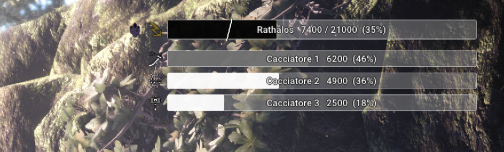

# MH World Overlay

Pannello informativo per **Monster Hunter: World** (PC, Steam), disegnato dentro il gioco tramite
[SharpPluginLoader](https://github.com/Fexty12573/SharpPluginLoader).



*(Anteprima con dati di prova)*

## Cosa mostra

- **Vita del mostro che stai combattendo**: compare quando colpisci un grande mostro e sparisce
  30 secondi dopo l'ultimo colpo. Se colpisci un altro mostro, il pannello passa a quello.
- **Soglia di cattura**: una linea `/` sulla barra indica il punto in cui il mostro diventa
  catturabile (quando nel gioco compare il teschio). Non c'è per i mostri non catturabili.
- **Debolezze elementali**: icone degli elementi prima della barra del mostro.
- **Danni del gruppo**: una barra per ogni cacciatore con nome, danni, percentuale e icona dell'arma.
  - In gruppo i danni sono quelli registrati dal gioco per ogni giocatore (totale della missione).
  - Da solo il valore è la vita persa dal mostro (comprende anche Felyne e ambiente).

Il pannello è trasparente, sta in alto a destra e **non riceve mouse o tastiera**: non blocca mai i
comandi del gioco. Le icone sono quelle del gioco, lette dalla tua copia di Monster Hunter: World
mentre il gioco è in esecuzione (il progetto non contiene file del gioco).

Colori: barra del mostro nera, altri giocatori bianca, tu grigia.

## Requisiti

| Cosa | Versione | Note |
|---|---|---|
| Monster Hunter: World (Steam, con o senza Iceborne) | ultima versione (**421810**) | Su versioni diverse i danni del gruppo si spengono da soli; il resto funziona finché SharpPluginLoader è compatibile. |
| [.NET 8 Desktop Runtime](https://dotnet.microsoft.com/download/dotnet/8.0) (x64) | 8.0.x | Necessario per SharpPluginLoader. |
| [SharpPluginLoader](https://github.com/Fexty12573/SharpPluginLoader/releases) | **2.0.0** | Il caricatore dei plugin C#. |

Provato in DirectX 11. SharpPluginLoader supporta anche DirectX 12, ma con l'overlay non è ancora stato provato.

## Installazione

> Prima di iniziare chiudi il gioco. Per trovare la cartella del gioco: in Steam, tasto destro su
> Monster Hunter: World → **Gestisci** → **Sfoglia file locali**. Di solito è
> `C:\Program Files (x86)\Steam\steamapps\common\Monster Hunter World`.

### 1. Installa .NET 8 Desktop Runtime

Scarica da https://dotnet.microsoft.com/download/dotnet/8.0 la voce **.NET Desktop Runtime 8.0.x**
per **Windows x64** e installala. Se hai già .NET 8 (Runtime o SDK) puoi saltare questo passo.

Per controllare, apri il Prompt dei comandi e scrivi `dotnet --list-runtimes`: deve comparire una
riga `Microsoft.WindowsDesktop.App 8.0.…`.

### 2. Installa SharpPluginLoader

1. Vai su https://github.com/Fexty12573/SharpPluginLoader/releases e scarica
   `SharpPluginLoader-2.0.0-win32.zip`.
2. Estrai **tutto il contenuto** dello zip nella cartella del gioco, così che ci siano:
   ```
   Monster Hunter World\
   ├─ MonsterHunterWorld.exe
   ├─ winmm.dll                         ← da SharpPluginLoader
   └─ nativePC\plugins\CSharp\Loader\    ← da SharpPluginLoader
   ```

### 3. Installa MH World Overlay

1. Vai nella pagina [Releases](../../releases) di questo progetto e scarica
   `MHWorldOverlay-x.y.z.zip`.
2. Estrai **tutto il contenuto** dello zip nella cartella del gioco. Il risultato deve essere:
   ```
   Monster Hunter World\
   └─ nativePC\plugins\CSharp\MHWorldOverlay\MHWorldOverlay.dll
   ```

### 4. Avvia il gioco

Avvia Monster Hunter: World da Steam come sempre. Il pannello compare in alto a destra appena
colpisci un grande mostro.

## Controllare che funzioni

Dopo aver avviato il gioco almeno una volta, apri il file
`nativePC\plugins\CSharp\Loader\SharpPluginLoader.log` nella cartella del gioco e cerca:

```
Loading plugin MHWorldOverlay
[MH World Overlay] Versione 421810: danni del gruppo attivi
```

Puoi anche premere **F9** nel gioco: si apre il menu di SharpPluginLoader (premi di nuovo F9 per
chiuderlo).

## Aggiornare

Chiudi il gioco ed estrai lo zip della nuova versione nella cartella del gioco, sovrascrivendo
`MHWorldOverlay.dll`.

## Disinstallare

- **Solo l'overlay**: cancella la cartella `nativePC\plugins\CSharp\MHWorldOverlay`.
- **Anche SharpPluginLoader**: cancella `winmm.dll` nella cartella del gioco e la cartella
  `nativePC\plugins\CSharp`.

## Problemi comuni

| Problema | Soluzione |
|---|---|
| Il pannello non compare | Compare solo dopo aver colpito un **grande** mostro. Controlla il log (sezione sopra): se manca `Loading plugin MHWorldOverlay`, il file non è nella cartella giusta. |
| Nel log non c'è niente / il file di log non esiste | SharpPluginLoader non è installato correttamente: controlla `winmm.dll` nella cartella del gioco e il .NET 8 Desktop Runtime. |
| `versione diversa da 421810, danni del gruppo spenti` | Il gioco ha una versione diversa da quella supportata: la vita del mostro funziona, i danni per giocatore no (da solo vedi comunque la vita persa dal mostro). |
| Un altro mod si disattiva o il gioco si chiude all'avvio | Alcuni mod che modificano le stesse funzioni del gioco (per esempio **Seamless Co-op**) non sono compatibili con SharpPluginLoader. Disattiva l'altro mod. |
| Icone mancanti | Le icone vengono dalla tua copia del gioco: verifica l'integrità dei file da Steam (Proprietà → File installati → Verifica integrità). |

## Compilare dal codice

Serve il [.NET 8 SDK](https://dotnet.microsoft.com/download/dotnet/8.0).

```
dotnet build -c Release
```

La DLL è in `bin\Release\net8.0\MHWorldOverlay.dll`. Per provare la grafica senza andare a caccia
c'è un'anteprima con dati finti: `dotnet build -c Release -p:DefineConstants=PREVIEW`.

## Avvertenze

- Usalo a tuo rischio. L'overlay **legge** soltanto i dati del gioco: non modifica danni, oggetti,
  missioni o matchmaking.
- Progetto non ufficiale, non affiliato né approvato da CAPCOM. Monster Hunter: World e le sue
  icone sono © CAPCOM.

## Riconoscimenti

- [SharpPluginLoader](https://github.com/Fexty12573/SharpPluginLoader) di Fexty12573 (MIT).
- [HunterPie](https://github.com/HunterPie/HunterPie) (Apache 2.0): dati dei mostri (soglie di
  cattura, debolezze) e indirizzi di memoria per i danni del gruppo. Dettagli in
  [THIRD-PARTY-NOTICES.md](THIRD-PARTY-NOTICES.md).

## Licenza

[MIT](LICENSE)

---

## English (short)

In-game overlay for **Monster Hunter: World** (PC) built on SharpPluginLoader: health bar of the
monster you are fighting with capture threshold marker, elemental weaknesses, and per-hunter damage
with weapon icons. Transparent, top-right, never captures input.

**Install:** install the [.NET 8 Desktop Runtime](https://dotnet.microsoft.com/download/dotnet/8.0)
(x64) → extract [SharpPluginLoader 2.0.0](https://github.com/Fexty12573/SharpPluginLoader/releases)
into the game folder → extract `MHWorldOverlay-x.y.z.zip` from [Releases](../../releases) into the
game folder (result: `nativePC\plugins\CSharp\MHWorldOverlay\MHWorldOverlay.dll`) → start the game.
Party damage requires game version 421810. Not compatible with mods that hook the same game
functions (e.g. Seamless Co-op).
